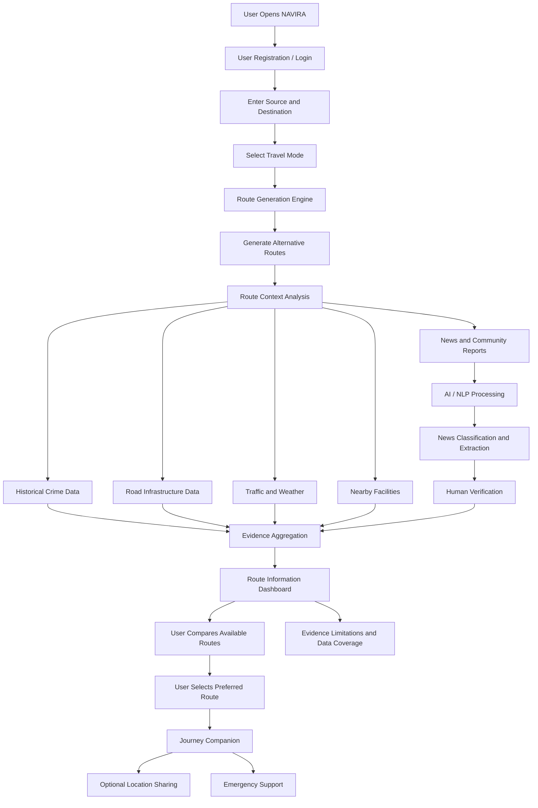

# 🧭 NAVIRA – AI-Powered Smart Navigation & Journey Awareness Platform

### *Safer Steps. Brighter Tomorrows.*

**NAVIRA** is a proposed AI-powered, women-centric navigation and journey-awareness platform designed to help users make more informed travel decisions through contextual route information, infrastructure awareness, historical data, community participation and intelligent assistance.

Rather than focusing only on the shortest or fastest route, NAVIRA aims to provide a broader understanding of the conditions and available information surrounding a journey.

---

## 🌍 1. Problem Statement

Traditional navigation applications primarily optimize routes based on distance and estimated travel time. However, these factors may not address all the concerns of people travelling alone, especially women.

Users may also need information about:

- Availability of mapped streetlights.
- Pedestrian-friendly infrastructure.
- Nearby hospitals and police facilities.
- Historical crime statistics.
- Reported local incidents.
- Traffic and weather conditions.
- Emergency support and trusted-contact sharing.

The lack of a unified platform combining these different sources of journey information creates an opportunity for a more context-aware navigation solution.

## 💡 2. Proposed Solution

NAVIRA aims to integrate navigation, AI/ML-based information processing, geographical data and emergency-support features into a single platform.

The application will:

1. Generate alternative routes between the source and destination.
2. Analyze available contextual information associated with each route.
3. Display mapped infrastructure and nearby facilities.
4. Process relevant news reports using NLP and machine learning.
5. Present historical statistics and community information with appropriate limitations.
6. Support emergency assistance and trusted-contact location sharing.
7. Help users make informed decisions based on available evidence.

**Core Vision:** Move beyond conventional navigation by introducing evidence-based journey awareness.

---

## ⚙️ 3. Proposed System Workflow

The following workflow describes how NAVIRA is intended to operate.



### Workflow Explanation

**Step 1: User Authentication**

Users will register or log in to access their personalized navigation experience.

**Step 2: Location Selection**

Users will enter their starting point and destination.

**Step 3: Route Generation**

The routing engine will generate alternative routes using geographical routing services.

**Step 4: Data Collection**

The system will collect available information from multiple sources:

- OpenStreetMap for geographical and infrastructure information.
- NCRB for historical aggregate crime statistics.
- Traffic APIs for traffic conditions.
- Weather APIs for environmental conditions.
- News sources for reported incidents.
- Nearby facility data for hospitals and police facilities.

**Step 5: AI/ML Processing**

The AI/ML module will process news reports, identify potentially relevant information, extract location-related details and identify duplicate reports.

**Step 6: Evidence Aggregation**

The system will organize available information according to route segments and geographical coverage.

**Step 7: Route Comparison**

Users will be able to compare available route information, including distance, estimated travel time, infrastructure and contextual conditions.

**Step 8: Journey Support**

Users will be able to save journeys and access proposed emergency-support and trusted-contact features.

---

## 🧠 4. Proposed AI/ML Architecture

NAVIRA aims to use machine learning and natural language processing to process unstructured information and support better information organization.

### A. News Classification

**Proposed algorithms:**
- TF-IDF
- Logistic Regression
- Naive Bayes (for comparison)

Purpose:
- Identify potentially relevant news reports.
- Categorize reports.
- Reduce irrelevant information.
- Support human verification.

### B. Named Entity Recognition (NER)

Purpose:
- Identify geographical locations.
- Extract dates and relevant entities.
- Identify incident-related keywords.
- Organize information for further analysis.

### C. Duplicate News Detection

Purpose:
- Identify similar reports.
- Reduce duplicate information.
- Maintain a cleaner information repository.

### D. Geospatial Analysis

Purpose:
- Associate geographical information with road segments.
- Identify nearby facilities.
- Analyze mapped infrastructure.
- Organize information around alternative routes.

### E. Evidence-Based Route Analysis

The proposed system will combine available contextual information to generate a route-information summary.

It will not claim that any route is completely safe or unsafe. It will communicate missing information, source reliability and geographical coverage.

---

## 🏗️ 5. Proposed Technology Stack

| Layer | Technology | Purpose |
|---|---|---|
| Frontend | React.js | Interactive user interface |
| Styling | CSS / Tailwind CSS | Responsive design |
| Mapping | Leaflet / React Leaflet | Interactive maps |
| Backend | Python | Application logic |
| API Framework | FastAPI | REST API development |
| Database | SQLite / PostgreSQL | Data storage |
| ORM | SQLAlchemy | Database operations |
| ML | Scikit-learn | Machine learning |
| NLP | NLTK / spaCy | Text processing |
| Data Processing | Pandas / NumPy | Data analysis |
| Geospatial | GeoPandas | Geographic data processing |
| Routing | OSRM / OpenRouteService | Route generation |
| Map Data | OpenStreetMap | Geographical information |
| Weather | Open-Meteo | Weather information |
| Traffic | TomTom API | Traffic information |
| Deployment | Render / Vercel | Application deployment |
| Version Control | Git / GitHub | Collaborative development |

*Final technology choices will depend on API availability, development time and implementation requirements.*

---

## 🗂️ 6. Proposed Project Architecture

```text
NAVIRA/
│
├── frontend/
│   ├── src/
│   │   ├── components/
│   │   ├── pages/
│   │   ├── maps/
│   │   ├── routes/
│   │   └── services/
│   │
│   └── package.json
│
├── backend/
│   ├── app/
│   │   ├── routers/
│   │   ├── models/
│   │   ├── services/
│   │   ├── agents/
│   │   └── main.py
│   │
│   ├── data/
│   │   ├── historical/
│   │   ├── infrastructure/
│   │   └── news/
│   │
│   └── requirements.txt
│
├── ml/
│   ├── preprocessing.py
│   ├── news_classifier.py
│   ├── location_extraction.py
│   └── evaluation.py
│
├── docs/
│   ├── architecture.md
│   └── workflow.md
│
└── README.md
```

---

## ✨ 7. Key Proposed Features

| Feature | Description |
|---|---|
| Smart Route Planning | Generate alternative routes |
| Multi-Mode Navigation | Support different travel modes |
| Infrastructure Awareness | Display mapped streetlights and pedestrian infrastructure |
| Historical Data Analysis | Present relevant historical statistics |
| AI News Intelligence | Classify and organize relevant news |
| Nearby Facilities | Locate hospitals and police facilities |
| Traffic Awareness | Display available traffic conditions |
| Weather Awareness | Provide weather context |
| Community Reporting | Allow users to submit local observations |
| Journey Companion | Save and manage journeys |
| Emergency Support | Provide emergency assistance options |
| Trusted Contacts | Support consent-based location sharing |

---

## 🚀 8. Innovation and Unique Selling Proposition

NAVIRA aims to differentiate itself through the integration of several journey-awareness capabilities.

**1. Multi-Source Information Integration**

Combines geographical, historical, environmental and community information instead of depending exclusively on conventional routing information.

**2. Infrastructure-Aware Navigation**

Focuses on mapped infrastructure such as streetlights and pedestrian facilities.

**3. AI-Assisted News Intelligence**

Uses NLP and machine learning to organize potentially relevant news information for human review.

**4. Evidence-First Approach**

Avoids unsupported safety percentages and communicates the limitations of available data.

**5. Integrated Journey Support**

Combines route planning, journey management, emergency-support options and trusted-contact sharing.

**Our USP:**

NAVIRA aims to transform conventional navigation into an evidence-based journey-awareness experience.

---

## 🌱 9. Social Impact

NAVIRA aims to contribute to society through:

- **Women's Empowerment:** Supporting informed and independent mobility.
- **Public Awareness:** Improving access to journey-related information.
- **Community Participation:** Encouraging responsible reporting of local infrastructure issues.
- **Urban Development:** Helping identify infrastructure information gaps.
- **Inclusive Mobility:** Extending the platform to students, pedestrians, elderly people and other travellers.
- **Technology for Social Good:** Applying AI, ML and geographical technologies to a meaningful social problem.

---

## 🔮 10. Future Scope

The platform can be expanded through:

1. Real-time GPS-based journey sharing.
2. Automated, consent-based emergency notifications.
3. Hindi and multilingual voice assistance.
4. Android and iOS applications.
5. Offline navigation support.
6. Verified streetlight and pedestrian infrastructure databases.
7. Advanced NLP and multilingual news processing.
8. Improved community moderation and verification.
9. Accessibility-aware route recommendations.
10. Integration with municipal authorities and NGOs.
11. Expansion to additional Indian cities.
12. Improved data privacy, encryption and security.

---

## 🔐 11. Privacy and Responsible Design

NAVIRA will follow privacy-conscious development principles:

- Collect only necessary personal information.
- Obtain explicit consent before sharing location.
- Use time-limited location-sharing links.
- Provide controls to revoke sharing.
- Avoid presenting unverified reports as confirmed incidents.
- Clearly communicate missing or outdated information.
- Avoid claiming that a route is guaranteed to be safe.

---

## 🎯 12. 24-Hour Hackathon Development Plan

| Timeline | Planned Work |
|---|---|
| Hour 0–2 | Requirement analysis and architecture |
| Hour 2–5 | Frontend and interactive map |
| Hour 5–9 | Backend APIs and route generation |
| Hour 9–13 | Data integration and infrastructure analysis |
| Hour 13–17 | ML/NLP news classification |
| Hour 17–20 | Journey management and emergency support |
| Hour 20–22 | Integration and testing |
| Hour 22–24 | Deployment and final demonstration |

The primary objective will be to develop a functional MVP demonstrating the core NAVIRA workflow.

---

## 🏁 13. Expected Outcome

The expected outcome is a functional prototype of NAVIRA that demonstrates how navigation, geographical information, historical data, AI-assisted information processing and journey-support capabilities can be brought together into one platform.

The project aims to provide users with additional contextual information to support informed travel decisions while maintaining transparency about data quality and limitations.

---

## 👥 14. Project Information

**Project Name:** NAVIRA

**Domain:** Artificial Intelligence | Machine Learning | Smart Mobility | Women Safety

**Development Approach:** 24-Hour Hackathon

**Target Users:** Women, students, pedestrians and urban travellers.

**Vision:** Building a more informed, inclusive and context-aware navigation experience.

### *NAVIRA – Safer Steps. Brighter Tomorrows.*

**Technology with Purpose. Navigation with Awareness.**